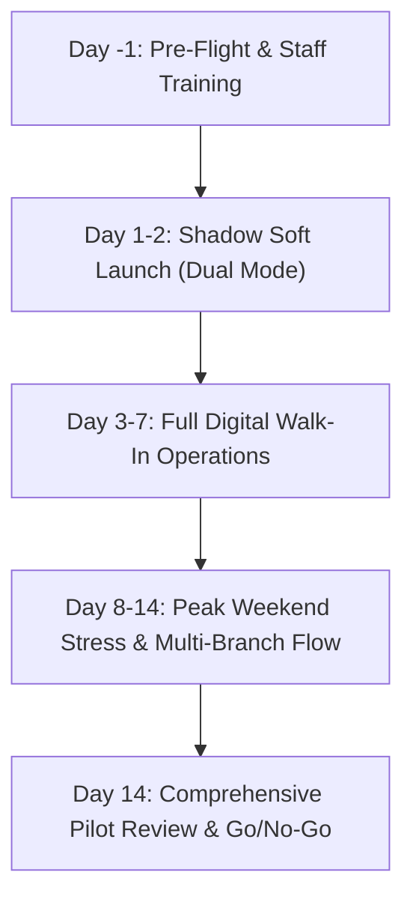

# SalonFlow SaaS — Real-World Pilot Testing Plan

**Document Version**: 1.0.0  
**Target Window**: 14-Day Controlled Single-Salon Pilot  
**Author**: Product Operations & Quality Assurance Lead  
**Objective**: Validate real-world hardware compatibility, physical counter workflows, customer mobile usability, and Web Push reliability in an active salon environment before general SaaS onboarding.

---

## 1. Pilot Salon Selection Criteria

To ensure rigorous validation without exposing high enterprise risk, select a partner salon meeting the following profile:

| Criteria | Target Requirement | Rationale |
|---|---|---|
| **Location** | Tier-1 / Tier-2 Indian Urban Metro (e.g. Mumbai, Bangalore, Pune) | Standard 4G/5G mobile connectivity and customer smartphone literacy. |
| **Branch Size** | 1 Single Branch (or 1 Main + 1 Small Satellite) | Allows testing single-branch and cross-branch isolation without overwhelming staff. |
| **Chairs / Stations** | 3 to 6 active styling stations | High enough for concurrent service flow, small enough for direct supervision. |
| **Daily Footfall** | 40 to 80 walk-in customers per day | Provides statistically significant token volume (500+ tokens over 7 days). |
| **Existing System** | Currently using paper token slips or physical notebook | Immediate comparison baseline for speed, waiting anxiety, and customer satisfaction. |
| **Staff Profile** | 1 Owner/Manager + 1 Receptionist + 3–4 Stylists | Exercises Owner dashboard, Receptionist walk-in intake, and Stylist "Call Next". |

---

## 2. Pre-Pilot Hardware & Infrastructure Checklist

Before Day 1 of the pilot, the operations team must verify the physical salon setup:

- [ ] **Counter Device (Staff Station)**:
  - 1x iPad (10.2" or larger, iOS 16+) or Android Tablet (10", Android 12+) with Google Chrome / Safari.
  - Wall or counter stand with permanent power supply.
  - Screen timeout set to "Never" or minimum 30 minutes.
- [ ] **QR Code Display**:
  - 2x High-resolution acrylic QR stands placed at the salon entrance and reception counter.
  - QR Code deep-links directly to `/salon/{salonSlug}/{branchSlug}?t={qrToken}`.
  - Clear customer signage: *"Scan to Join Queue & Track Your Turn on Your Phone"*.
- [ ] **Network Connectivity**:
  - Primary Salon Wi-Fi (minimum 25 Mbps broadband).
  - Backup 4G/5G mobile hotspot configured on the counter tablet to handle ISP downtime.
- [ ] **Emergency Fallback Equipment**:
  - 1x Physical paper token receipt book kept in the reception drawer in case of catastrophic device failure.

---

## 3. Real-Device Web Push Testing Protocol

Web Push behaves differently across real mobile operating systems. The pilot team must execute the following protocol on real physical hardware:

### Protocol A: Android Chrome (Android 12, 13, 14)
1. Customer scans QR code via native camera app or Google Lens.
2. Branch intake form opens in Chrome. Customer enters Name and Mobile Number, selects "Haircut + Beard Trim".
3. Form submits. Customer lands on `/token/{publicId}` tracking screen.
4. "Enable Push Notifications" banner appears with clear explanation.
5. Customer taps "Notify Me on Phone".
6. Native browser dialog prompts: *"salonflow.com wants to send you notifications"*. Tap **Allow**.
7. Test Verification:
   - Receptionist taps "Call Next".
   - Customer phone sounds chime and displays notification: *"You're Up Next! Token A014 has been called at Counter 2"*.
   - Customer taps notification &rarr; Phone immediately brings SalonFlow tab into foreground.

### Protocol B: Apple iOS Safari (iOS 16.4, 17, 18)
> **Crucial iOS Constraint**: Apple requires web apps to be added to the Home Screen (standalone PWA) before the Web Push API (`PushManager`) is accessible in Safari.

1. Customer scans QR code via iPhone Camera app.
2. Page opens in Safari. Customer submits intake form.
3. If customer is on iOS Safari (not in standalone mode):
   - SalonFlow UI detects iOS Safari and displays an instructional modal:
     *"To receive lock-screen alerts on iPhone, tap Share (box with arrow) and select 'Add to Home Screen'"*.
4. Customer adds app to Home Screen and launches from icon.
5. In standalone mode, customer taps "Enable Turn Alerts".
6. iOS displays native prompt: *"SalonFlow would like to send you notifications"*. Tap **Allow**.
7. Test Verification:
   - Turn screen off (lock screen).
   - Receptionist advances queue.
   - Lock screen illuminates with alert: *"Approaching: 1 person ahead of you for Token A014"*.

### Protocol C: Customer Declines Push Permissions
1. Customer taps "Block" or closes the permission modal.
2. SalonFlow UI gracefully falls back:
   - "Push Disabled" badge shown with fallback tip: *"Keep this browser tab open. Your queue position updates automatically in real-time"*.
   - Real-time SSE stream continues to update position (`peopleAhead`, `estimatedWaitMinutes`) live on screen without page refresh.

---

## 4. Phase-by-Phase Pilot Rollout Schedule

### Phase 1: Pre-Flight & Staff Training (Day -1)
- **Duration**: 4 hours (after salon closing hours).
- **Activities**:
  1. Provision Salon Organization and Branch in SalonFlow.
  2. Configure services catalog with exact salon prices (e.g. Haircut ₹250, Shave ₹150, Facial ₹800) and durations.
  3. Set active styling stations (e.g., 4 stations) and buffer time (5 mins).
  4. Train Receptionist on:
     - Opening `/owner/dashboard`.
     - Assisted walk-in entry (customer has no smartphone or refuses to scan).
     - "Call Next", "Start Service", "Complete", "Skip", and "Re-queue".
  5. Conduct 10 synthetic dry-run token cycles with staff phones.

### Phase 2: Shadow Soft Launch (Days 1–2)
- **Mode**: Dual mode (staff logs tokens into SalonFlow while maintaining existing paper log).
- **Goals**:
  - Verify that staff can issue tokens in <15 seconds per walk-in.
  - Measure discrepancies between estimated wait time and actual service duration.
  - Verify that no customer feels ignored or confused.

### Phase 3: Full Digital Walk-In Operations (Days 3–7)
- **Mode**: 100% digital token generation (QR code scan at door + Receptionist tablet entry).
- **Goals**:
  - Track real customer adoption: percentage scanning QR vs asking receptionist.
  - Verify real-time SSE stream stability across varying mobile carrier networks (Jio, Airtel, Vi).
  - Test milestone alerts: "Approaching (3 ahead)", "Approaching (1 ahead)", "Called".

### Phase 4: Peak Weekend Stress Testing (Days 8–14)
- **Mode**: Heavy Saturday/Sunday peak hours (10:00 AM – 8:00 PM).
- **Goals**:
  - High queue depth (15–25 waiting customers).
  - Rapid state transitions (stylists completing services every 15–20 minutes).
  - Test queue skipping (customer stepped out for coffee) and re-queuing upon return.

---

## 5. Failure Mode & Disaster Recovery Drills (Simulated during Pilot)

| Scenario | Simulated Action | Expected System Behavior | Operator Action |
|---|---|---|---|
| **Salon Wi-Fi Outage** | Turn off router at 2:00 PM | Tablet switches to 4G hotspot in <5s; SSE auto-reconnects | Continue operations seamlessly on cellular data. |
| **Customer Smartphone Battery Dies** | Customer informs counter | Receptionist looks up customer by name or token number | Receptionist announces token verbally; marks "In Service". |
| **Customer No-Show at Call Time** | Customer does not respond within 3 minutes | Staff taps "Skip" | Token moves to Skipped list; next customer in FIFO order is called. |
| **Customer Returns After Being Skipped** | Customer returns 20 minutes later | Staff taps "Re-queue" | New token issued with updated number; previous push subscription migrated. |
| **Accidental Double Tap by Customer** | Customer taps "Join Queue" twice in 200ms | Idempotency guard activates | Exactly 1 token issued; second tap returns identical token screen. |

---

## 6. Pilot Success Metrics & Exit Criteria

The pilot will be declared a **SUCCESS** and certified for full SaaS general availability if the following KPIs are satisfied over the 14-day evaluation:

1. **Queue Monotonicity**: **100%** (Zero out-of-order sequence assignments or missing numbers).
2. **Double Booking / Race Incidents**: **0** (Zero instances of two customers assigned the same token number).
3. **Cross-Tenant Data Leakage**: **0** (Zero instances of customer data or salon settings appearing in another tenant's view).
4. **Push Notification Delivery Rate**: **>= 85%** on Android, **>= 70%** on iOS.
5. **Wait Time Estimation Error**: Average absolute error **<= 7 minutes** across completed tokens.
6. **No-Show Rate Reduction**: Measurable reduction of no-shows by **>= 30%** compared to historical paper notebook baseline.
7. **Staff Satisfaction Score**: **>= 4.5 / 5.0** reported by salon owner and styling staff.

