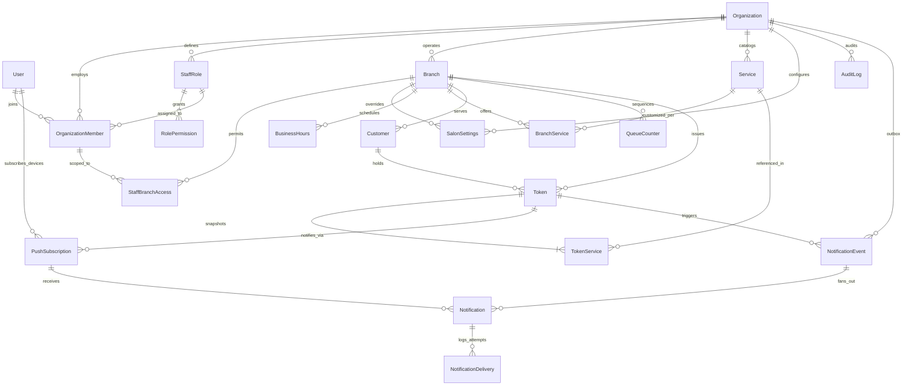

# Entity Relationship Diagram — SalonFlow SaaS

---

## Composite Tenant Key Guarantees

Every tenant-owned child entity embeds `organizationId` in its foreign key relationship to parent entities:
- `(organizationId, branchId)` -> `Branch(organizationId, id)`
- `(organizationId, memberId)` -> `OrganizationMember(organizationId, id)`
- `(organizationId, serviceId)` -> `Service(organizationId, id)`
- `(organizationId, branchId, customerId)` -> `Customer(organizationId, branchId, id)`
- `(organizationId, tokenId)` -> `Token(organizationId, id)`
- `(organizationId, notificationEventId)` -> `NotificationEvent(organizationId, id)`
- `(organizationId, notificationId)` -> `Notification(organizationId, id)`

This makes cross-tenant relational corruption (e.g., linking Salon A's token to Salon B's customer or branch) structurally impossible inside PostgreSQL.
